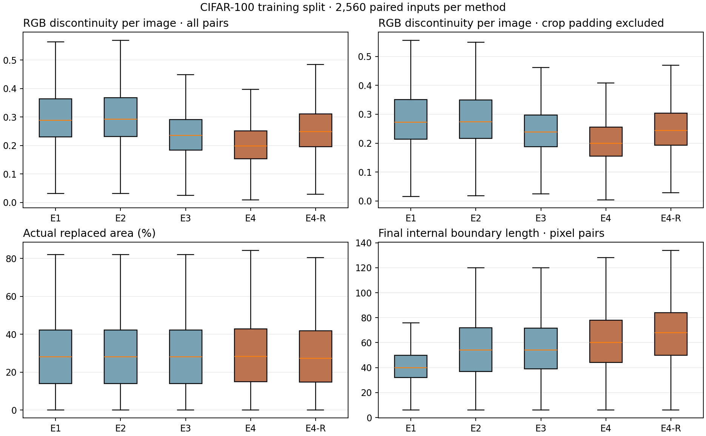

# Seam-Aware CutMix — AI6103 Final Project

[](https://github.com/Tailai-001/6103project/actions/workflows/ci.yml)

**Content selection and local boundary optimization for image-mixing augmentation.** This project extends **CutMix (ICCV 2019)** and its released code, following the course track “take a conference paper from 2019 or later and develop an improvement on its existing code base.”

- Original paper: [Yun et al., *CutMix: Regularization Strategy to Train Strong Classifiers with Localizable Features*](https://arxiv.org/abs/1905.04899).
- Original code: [clovaai/CutMix-PyTorch](https://github.com/clovaai/CutMix-PyTorch), preserved under [third_party/](third_party/README.md).
- Our implementation: **seven augmentation policies, one training loop, CIFAR-100 and a four-stage CIFAR ResNet-18**. All implementations and the evidence from 21 complete training runs are included on `main`.

## 1. Install

Use **64-bit Python 3.11** in an isolated environment. The reproduction environment pins PyTorch 2.5.1 and torchvision 0.20.1; it does not require the latest PyTorch. Run commands from the repository root.

```bash
git clone https://github.com/Tailai-001/6103project.git
cd 6103project
python3.11 -m venv .venv
source .venv/bin/activate
python -m pip install --upgrade pip
```

On **Linux without a GPU**, install the CPU wheels first:

```bash
python -m pip install torch==2.5.1 torchvision==0.20.1 --index-url https://download.pytorch.org/whl/cpu
```

Then, on Linux or macOS:

```bash
python -m pip install -r requirements-dev.txt
python -m pip check
```

`requirements-dev.txt` includes the runtime packages and pytest. For Windows activation, CUDA wheels, Apple MPS and common setup errors, see [the running guide](docs/running.md). The wheel commands follow the [official PyTorch version instructions](https://pytorch.org/get-started/previous-versions/#v251).

## 2. Check that it runs — no dataset or GPU needed

```bash
python scripts/verify_repository.py
python scripts/smoke_test.py
python -m pytest -q
```

The first command uses only the standard library to verify the upstream snapshot, fixed split hashes, Python syntax and documentation links. The smoke command runs **all seven policies**, checks final-mask label weights, performs real forward/backward optimizer steps through the shared ResNet-18 trainer, evaluates a clean batch, and saves/reloads a temporary checkpoint. A successful run ends with `"status": "passed"`. Synthetic smoke inputs verify execution; they are not accuracy experiments. Pytest discovers the full suite, including the seam and dynamic-programming tests; unavailable accelerator tests are reported as skips.

## 3. Reproduce the reported tables and figures

```bash
python analysis/reproduce_results.py --out-dir outputs/reproduced
```

This rebuilds tables and plots from the committed training logs, boundary audit and saved validation predictions. It checks the local confirmation metrics against those predictions and writes an input-hash manifest. **No dataset, checkpoint, training or network access is required.** It leaves the committed evidence unchanged.

Outputs include `tables/main_results.csv` (18 original runs), `tables/local_confirmation.csv` (3 confirmation runs), boundary and efficiency tables, and four figures under `figures/`. To additionally verify historical training-source hashes in a full Git clone:

```bash
python analysis/audit_training_evidence.py --out outputs/training_evidence_audit.json
```

The historical-source check needs Git history; a GitHub source ZIP can run the smoke test and table reproduction but does not contain that history.

## 4. Train and evaluate on CIFAR-100

Data and model weights are not bundled. CIFAR-100 is public; this explicit command downloads its official archive and verifies the supplied split:

```bash
python scripts/prepare_data.py --download
```

The committed indices define **45,000 training and 5,000 validation images**, with 450/50 per class. Do not regenerate them. An existing dataset can be checked using `--data-root /path/to/cifar100`; for training at a different location, edit `data.root` in your copied configuration.

Run a short integration check through the actual training CLI:

```bash
python train.py --config configs/smoke_cpu.yaml --max-batches 2 --device cpu --run-name smoke_e4
```

This trains two small batches and validates on the full fixed 5,000-image split. It creates `logs/smoke_e4.csv` and `checkpoints/smoke_e4/{best,last}.pth`. It is an execution check, not a formal result. Run names must be unique; existing runs are protected from overwriting.

For a complete **200-epoch** experiment, use the recorded configurations. CUDA is selected automatically when available:

```bash
# Original random CutMix baseline
python train.py --config configs/main.yaml --policy random --run-name e1_s42
# Our E3 rectangle selection, E4 boundary optimization, and random-boundary control
python train.py --config configs/c_seam_aware_k4_s42.yaml --run-name e3_s42
python train.py --config configs/c_seam_dp_k4_s42.yaml --run-name e4_s42
python train.py --config configs/c_seam_random_k4_s42.yaml --run-name e4r_s42
```

CPU training is supported; a GPU is practical for full experiments. On Apple silicon, add **`--device mps --augmentation-device cpu`**: the exact float64 augmentation scoring stays on CPU and the model runs on MPS. The [running guide](docs/running.md) gives the complete command and output conventions.

Evaluate a checkpoint produced by your run:

```bash
python evaluate.py --checkpoint checkpoints/e4_s42/best.pth --run-id e4_s42 --log logs/e4_s42.csv --split validation --device cpu --out outputs/e4_s42_validation.json
```

This reports Top-1 (%), Macro-F1, loss and checkpoint provenance. `--split test` is available for a frozen, complete formal run and requires its log. **All results currently reported by this project are validation results; the official test set has not been evaluated.** Pretrained checkpoints are not hosted in this repository, so checkpoint evaluation requires completing a training run first.

## 5. Implemented methods

| ID | Policy | Implementation | Configuration |
|---|---|---|---|
| E0 | `none` | Plain training | `configs/main.yaml` |
| E1 | `random` | Original random rectangle | `main.yaml` with `--policy random` |
| E2-S | `source_edge` | Source-only Sobel content score | `configs/b_source_edge_k4_s42.yaml` |
| E2 | `dual_edge` | Source score minus target score | `configs/b_dual_edge_k4_s42.yaml` |
| E3 | `seam_aware` | E2 plus RGB seam compatibility | `configs/c_seam_aware_k4_s42.yaml` |
| E4 | `seam_dp` | E3 plus constrained joint left/right DP | `configs/c_seam_dp_k4_s42.yaml` |
| E4-R | `seam_random` | E3 plus a random-cost boundary control | `configs/c_seam_random_k4_s42.yaml` |

E1–E3 share area-matched rectangle proposals. E4/E4-R use the same displacement, continuity, minimum-width and area-budget rules; their final shape distributions are reported rather than assumed identical. Every method calculates label weights from the **final binary mask**. The default E4 radius is explicitly set to 2 in its configuration; radius 0 reduces E4 to E3. No additional network or inference-time augmentation is introduced.

The [experiment protocol](docs/experiment_protocol.md) records the formulas, sampling rules, hyperparameters, checkpoint selection and measurement scope. [Module details](augmentations/README.md) link the implementation and metadata definitions.

## 6. Measured results

Our clearest result is **improved boundary compatibility**: E4 reduces the mean RGB jump from **0.3058 to 0.2098**, **31.4%** relative to E1, in a paired audit of 2,560 training inputs. The direction remains after excluding crop padding. Classification stays around 80% validation Top-1; a repeatable accuracy gain has not been established.

| Host and seed | Method | Best validation Top-1 (%) | Last 10 epochs mean (%) |
|---|---|---:|---:|
| C-main RTX 4090, seed 42 | E3 | 79.72 | 79.524 |
| C-main RTX 4090, seed 42 | E4 | 80.30 | 80.156 |
| C-main RTX 4090, seed 42 | E4-R | 79.46 | 79.236 |
| M5 Max, seed 43 | E1 | 79.92 | 79.824 |
| M5 Max, seed 43 | E4 | 79.78 | 79.546 |
| M5 Max, seed 43 | E4-R | 80.08 | 79.846 |

Compare methods within a host group. These two groups are not a controlled multi-seed study. The 18 original runs comprise A's 2 baselines, B's 5 content-selection runs and C's 11 seam/control/ablation runs; the three additional same-host runs bring the total to 21.

- [Original 18-run table](results/tables/main_results.md) and [raw CSV](results/tables/main_results.csv).
- [Same-host confirmation](results/local_audit/local_confirmation.md), [raw logs](results/local_audit/raw_logs/) and [saved predictions](results/local_audit/validation_predictions.csv).
- [Boundary measurements](results/tables/d_boundary_quality.md), [efficiency](results/tables/d_efficiency.csv) and [paired sensitivity analysis](results/local_audit/paired_boundary_evidence.md).
- [Integrated result analysis](RESULTS_D.md) and [independent evidence audit](RESULTS_AUDIT.md).



## 7. Repository map and provenance

| Path | Purpose |
|---|---|
| `train.py`, `evaluate.py` | Shared training and checkpoint evaluation |
| `augmentations/`, `models/`, `data/` | All methods, CIFAR ResNet-18, data loader and fixed split |
| `configs/` | Recorded formal, ablation, confirmation and short smoke configurations |
| `scripts/` | Setup checks, smoke execution and original experiment runners |
| `analysis/` | Result reproduction, boundary analysis and evidence verification |
| `tests/` | Complete correctness and integration test suite |
| `results/`, `experiments/registry.csv` | Small public logs, metadata, predictions, tables and plots |
| `docs/` | Running guide, implemented protocol, paper notes and archived original brief |
| `third_party/CutMix-PyTorch/` | Unmodified official reference snapshot with its LICENSE and NOTICE |

The [original A handoff](<Baseline Implementation & Training Infrastructure (Member A)/README_A.md>) and historical [B](README_B.md)/[C](README_C.md) notes preserve how the project developed. The root entry points and this README are the current delivery interface; the archived A directory and `third_party/` are not the commands to launch the integrated project. Report and presentation documents are submitted separately; reproducible code evidence is included here.

The upstream snapshot is pinned to commit `2d8eb68faff7fe4962776ad51d175c3b01a25734` and checked against its [per-file manifest](third_party/cutmix_provenance.json). Adaptations are outside that directory. See [NOTICE.md](NOTICE.md) for attribution and retained licensing, and [the submission validation record](docs/submission_validation.md) for the checks actually performed.
