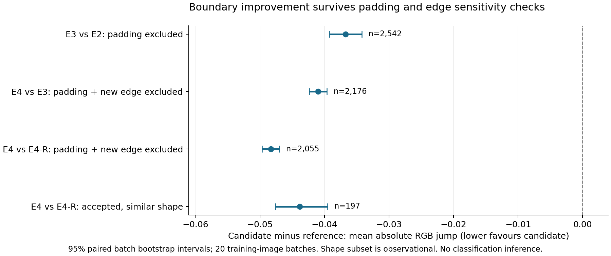
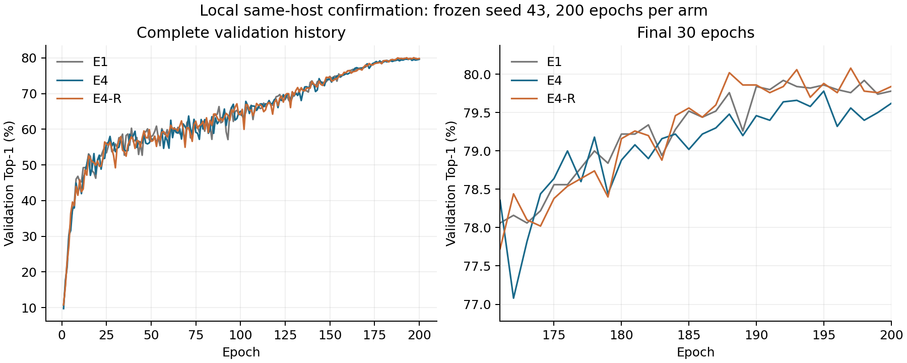

# 补充核查与本机确认实验

本页核查实际推送的代码、原始日志和逐样本记录。基于 D 分支提交 `8408c039b0ad33b97ffc8f9214135f024ef71efb`；不把 README 的任务勾选视为完成证据，也不把各成员尚未合并的 PR 视为已进入 main。

## 已有工作完成到哪里

| 部分 | 实际交付 | 本次核查与限制 |
|---|---|---|
| A | 统一训练框架、固定划分、E0/E1 两个 200-epoch 日志 | 日志连续完整，结果可重算；缺少每次运行的源码哈希与本机可用历史权重 |
| B | source/dual edge、K 消融，5 个 200-epoch 日志 | 已保存配置、历史源码哈希、样本数与汇总表一致 |
| C | E3/E4/E4-R、β/r/μ 消融，11 个 200-epoch 日志 | 有完整训练证据；分布在不同 4090 主机，不能把全部方法直接当作严格同机对照 |
| D | 18 次训练汇总、验证评价入口、2,560 图配对增强审计与报告图表 | 足以说明增强行为；原有分类对照均为 seed 42，没有同机 E1/E4/E4-R 三臂复核 |

[训练证据审计 JSON](results/local_audit/training_evidence_audit.json) 独立检查 18 份日志的 200 轮连续性、每轮 45,000 样本、有限数值、最佳值与末 10 轮均值、固定划分；B/C 还核对保存配置及训练时历史源码哈希。**这不等同于重新训练或重新验证原来的 checkpoint。** 当前电脑没有成员的历史权重。

## 已补：接缝结论的敏感性分析

复用 D 的同一批配对输入，无新增分类训练或参数搜索。每个样本共用图像、供体和基础矩形；两组都存在有效接缝才进入比较。按原始 20 个完整 batch 做 4,000 次配对 bootstrap，保留同一批内供体排列的依赖，不把所有像素当作独立样本。

RGB 指标为跨最终二值 Mask 边界的四邻接像素对之通道平均绝对差，按有效像素对加权。下面全部排除任意一端含真实 RandomCrop 填充的像素对；负值表示候选方法更平滑。

| 比较与样本范围 | 配对图数 | RGB 差：候选 − 对照 | 95% batch bootstrap 区间 |
|---|---:|---:|---|
| E3 − E2 | 2,542 | −0.03675 | [−0.03925, −0.03418] |
| E4 − E3；两组均未新增图像外边缘贴边 | 2,176 | −0.04100 | [−0.04235, −0.03961] |
| E4 − E4-R；两组均未新增贴边 | 2,055 | −0.04830 | [−0.04969, −0.04698] |
| E4 − E4-R；均接受路径、未新增贴边、形状接近 | 197 | −0.04382 | [−0.04761, −0.03953] |



“形状接近”在分析前固定为：替换面积比绝对差 ≤0.02、长短边界长度比 ≤1.10、拐弯数差 ≤2；筛选不使用 RGB 结果。它只保留 197/2,560 个输入，是**条件性的观察子集**，不能替代完全匹配形状的随机对照。完整口径、分母和来源哈希见 [逐项结果](results/local_audit/paired_boundary_evidence.md)、[CSV](results/local_audit/paired_boundary_evidence.csv)、[JSON](results/local_audit/paired_boundary_evidence.json)。

**可写进报告：** 在本批固定训练图像的配对审计中，E3/E4 的 RGB 连续性改善在排除真实填充与新增贴边后仍存在；E4 对 E4-R 的改善在预先定义的形状接近子集中也保持同一方向。这些区间描述强制混合 `p=1` 的增强诊断，不描述 `p=0.5` 分类训练的随机种子不确定性。

另有 **149/2,342（6.36%）** 个已接受且改变形状的 E4 样本，其完整最终接缝的 RGB 差比 E3 更大。因此应写“平均改善”，不能写“每张图都改善”或“DP 保证全边界指标下降”。DP 的局部目标与最终完整边界评价口径不同，这个现象本身不代表代码实现错误。

## 已补：本地训练与评价可靠性检查

- 原有测试 106 项通过、1 项 CUDA 专用测试跳过；新增检查后 **133 项通过、1 项 CUDA 专用测试跳过**，含真实 Apple MPS 上的多步 ResNet 反向训练与分类配对计数核对。
- 同一随机状态下，E1/E3/E4/E4-R 的供体、基础矩形、后续输入随机流保持一致；标签权重仍由最终 Mask 面积决定。
- 新增可选 `--device mps --augmentation-device cpu`：增强保留 CPU 上原始 float64 计算，模型用 Apple GPU；所有方法继续共用一个训练循环。原有 CUDA 默认路径保留。
- 本机 torch 2.5.1 预检发现异步 CPU→MPS 传输会导致错误损失；改成同步传输后，多步训练与 CPU 参考结果一致。修复仅涉及新增本地执行路径。失败的预检记录明确排除，不能作为分类结果。
- 评价入口会拒绝 NaN/Inf、越界准确率、空数据和非有限模型输出；补了手算损失与混淆矩阵对照，防止坏记录被当成有效证据。

结果见 [测试记录](results/local_audit/final_tests.txt)、[预检排除说明](results/local_audit/preflight_notes.json)。`third_party/CutMix-PyTorch/` 和 A/B/C 原始训练结果保持原样。

## 已完成：同机 E1 / E4 / E4-R 分类复核

采用新的 **seed 43**，本机 Apple M5 Max，三臂使用相同 CPU 增强 + MPS 模型路径，各跑 200 轮。配置在看到本次正式验证分数前冻结，沿用 C 默认 E4 `r=2, μ=0.05` 与训练集形状校准的随机臂；不换成消融中事后较好的 r=3。相同 45,000/5,000 固定划分，官方测试集未评价。

详细 [实验计划](results/local_audit/EXPERIMENT_PLAN.md) 已在正式启动前提交。三组均完成 200 轮、每轮 45,000 张训练图像，退出码均为 0；最佳 checkpoint 已独立加载到 CPU，在同一干净验证集上复评，准确率全部与训练日志完全一致。

| 方法 | 最佳 epoch | 最佳验证 Top-1 | 最后 1 轮 | 末 10 轮均值 | CPU 复评 Macro-F1 |
|---|---:|---:|---:|---:|---:|
| E1 Original CutMix | 192 | 79.92% | 79.78% | 79.824% | 0.79818 |
| E4 DP boundary | 195 | 79.78% | 79.62% | 79.546% | 0.79768 |
| E4-R Random boundary | 197 | 80.08% | 79.84% | 79.846% | 0.79964 |

本次 **E4 − E1 = −0.14 个百分点**，末 10 轮均值差为 **−0.278 个百分点**；**E4 − E4-R = −0.30 个百分点**，末 10 轮差为 **−0.300 个百分点**。因此本次分类结果没有显示 E4 优势，且不是只在最佳 epoch 的口径下如此。

对同一批 5,000 张验证图像，E4 相对 E1 独自答对 275 张、反向为 282 张；E4 相对 E4-R 独自答对 257 张、反向为 272 张。净差为 7 和 15 张，与准确率差一致。这是描述性的配对计数，不能当作跨训练 seed 的显著性检验。



完整 [结果表](results/local_audit/local_confirmation.md)、[CSV](results/local_audit/local_confirmation.csv)、[含 checkpoint 哈希的 JSON](results/local_audit/local_confirmation.json)、[三份完整日志](results/local_audit/raw_logs/)、[运行时配置与环境](results/local_audit/run_metadata/)、[逐图验证预测](results/local_audit/validation_predictions.csv) 已保存。权重和数据只留本地。三臂仍是顺序训练；E4-R 后半程单轮耗时明显增加，本机整段墙钟耗时不宜直接作为算法效率比较，效率分析继续引用 D 的同环境同步增强计时。

这项实验填上了“没有同机三臂对照”的缺口，并提供一个新 seed 的独立复核。旧 seed-42 的 C-main 上 E4 对 E4-R 为 +0.84 个百分点，本次 seed-43 则为 −0.30 个百分点，**效果方向没有稳定复现**。由于主机与执行后端也改变了，不能把这称为严格控制的双 seed 实验，也不能归因于 seed 本身。仍需多 seed 同环境研究才能判断小差异；本次不继续按验证结果挑配置或重跑。

## 当前可用于报告的结论

1. **实现和实验交付有实物证据。** 已有 18 份正式训练日志及相关代码；本次追加测试通过，未发现足以否定既有结果的实现错误。缺少历史权重的部分仍不能独立复评。
2. **接缝更平滑有较明确的直接证据。** 新增分析支持平均 RGB 边界质量改善，且不完全由填充或贴边解释；这不等于语义更正确。
3. **没有证据表明接缝改善带来稳定的分类增益。** 本次同机 E4 为 79.78%，低于 E1 的 79.92% 和 E4-R 的 80.08%；与旧 E4 对随机边界的正向结果方向不同。可报告“低层 RGB 连续性改善，分类提升未稳定复现”，不能写“我们稳定超过 CutMix”，也不能据一个 seed 反过来断言 E4 普遍更差。官方测试与多 seed 显著性均未建立。

## 复现本次补充

```bash
python -m pytest tests -q
python analysis/audit_training_evidence.py
python analysis/paired_boundary_evidence.py
python analysis/plot_paired_boundary_evidence.py
# 需已有本地 CIFAR-100；三个正式运行按顺序执行，拒绝覆盖已有运行记录
python scripts/run_local_confirmation.py
# 完成后独立复评最佳权重，并导出小型证据与曲线；不读取官方测试集
python analysis/compile_local_confirmation.py
```
