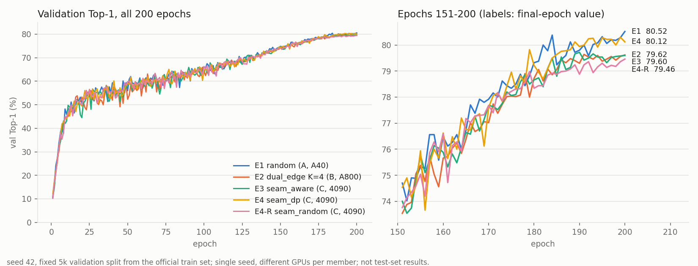

# 阶段 C：正式训练结果（E3 / E4 / E4-R）

三组 C 方法均通过统一 `train.py` 完成 200 epoch 训练。本文件只记录**实测值**和可追溯的来源，方法与实现说明见根目录 [README_C.md](../../README_C.md)。

以下全部为 **seed 42、固定 5,000 张干净验证集**上的结果。**不是官方测试集指标，也不是多 seed 均值**。β、r、μ、面积预算是预先指定的**暂定值**，没有在验证集上搜索。

| 实验 | policy | 最佳 Val Top-1 (%) | 最佳 epoch | 末 epoch (%) | 末 10 epoch 均值 (%) | 每 epoch (s) | 完整进程 (min) |
|---|---|---:|---:|---:|---:|---:|---:|
| E3 | `seam_aware`（β=1） | 79.72 | 190 | 79.60 | 79.52 | 11.43 | 38.39 |
| E4 | `seam_dp`（r=2, μ=0.05, min_width=2, budget=0.2） | **80.30** | 199 | 80.12 | 80.16 | 13.90 | 46.60 |
| E4-R | `seam_random`（同 E4，`seam_random_mu=0.225`） | 79.46 | 200 | 79.46 | 79.24 | 13.95 | 46.76 |

三组共同设置：K=4、γ=0.5、α=1、p=0.5、batch 128、SGD lr 0.1、cosine、200 epoch，与 B 的 E2 配置只在 `augmentation` 段不同。环境：RTX 4090，torch 2.5.1+cu124，Python 3.12.3。

**已有结果作为背景**（来自 A 的主分支日志和 B 的 PR #1，均为 seed 42、同一验证集，但 GPU 不同）：

| 来源 | 实验 | 最佳 (%) | 末 10 epoch 均值 (%) | 环境 |
|---|---|---:|---:|---|
| A | E0 none | 77.74 | 77.53 | A40 |
| A | E1 random | 80.52 | 80.12 | A40 |
| B | K=1 控制（等价 E1 增强） | 80.06 | 79.80 | A800 |
| B | E2 dual_edge K=4 | 79.64 | 79.52 | A800 |
| B | E2-S source_edge K=4 | 80.36 | 80.20 | A800 |

"末 10 epoch 均值"取第 191–200 epoch 验证准确率的平均，用来减少只看单个最佳 epoch 带来的偶然性。

## 结论与解释

**1. E4 比它的随机边界对照 E4-R 高**：最佳高 0.84 个百分点，末 10 epoch 均值高 0.92 个百分点，最后 20 个 epoch 里每个 epoch 都高于 E4-R。两者硬件、代码、seed、基础矩形、约束、回退规则完全相同，平均拐弯数也已校准一致，唯一区别是 DP 的代价来自图像接缝还是随机噪声。这是本次结果里控制最干净的对比，**支持"边界跟随图像内容"比"同样不规则但随机的边界"更好**，而不是不规则形状本身带来的。

**2. E3 与 E2 没有可见差异**：最佳 79.72 对 79.64（+0.08），末 10 epoch 均值完全相同（79.52）。在矩形选区里加入接缝惩罚，**本次没有测到分类收益**。两者在不同 GPU 上训练，这么小的差别在单 seed 下无法解释。

**3. E4 比 E3 高**：最佳 +0.58，末 10 epoch 均值 +0.63，同一台 4090。E4 在 E3 的矩形基础上只改了左右边界，说明这一步有作用的可能性，但 E4 同时改变了面积（预算 ±20%）和形状，单凭这一项不能完全归因于接缝降低。

**4. 没有方法确定超过原版 CutMix**：E4 最佳 80.30 低于 A 的 E1 80.52（−0.22），末 10 epoch 均值 80.16 与 E1 的 80.12 基本持平。E1 在 A40、torch 2.9.1 上训练，跨环境只作背景，**不能声称 E4 超过或不如 E1**。E2-S（80.36）同样处于这个范围。

**5. 解释边界**：
- 全部是单 seed。CIFAR-100 上 ResNet-18 不同 seed 之间通常有零点几个百分点的波动，本次最大差距（E4 对 E4-R 的 0.8–0.9 个百分点）有参考意义，但**不构成统计显著性证据**，需要多 seed 复核。
- 相邻 epoch 的验证准确率高度相关，"最后 20 个 epoch 全部更高"不等于 20 次独立证据。
- 检查点按最佳验证准确率选择，最佳值本身略偏乐观，所以同时报告了末 epoch 和末 10 epoch 均值。
- 参数是暂定值，没有做验证集搜索。β、r、μ 的消融还没有做。
- 更低的接缝颜色差不等于更高语义质量，人工接缝也可能有正则化作用（见 README 第 1 节）。

## 正确性与可追溯性

- 三组均为 45,000 张训练样本 × 连续 200 epoch，日志无缺失。
- 运行时的 `config.json` 与仓库 `configs/c_*.yaml` 逐字段一致。
- `environment.json` 中记录的 `augmentations/`、`models/`、`data/` 全部源文件与 `train.py` 的 SHA-256，均与提交 `d2205b9` 中的文件一致；固定划分的 SHA-256 与 A/B 相同。
- 训练前在服务器上运行测试：104 passed（含 B 的 CUDA 测试），见 `tests.txt`。
- 三组按顺序单独运行，没有并发抢占 GPU；每组开始前写入 `experiments/registry.csv`。

## 效率

增强耗时在同一台 RTX 4090 上测量，GPU 空闲，同步计时，10 次预热、50 次重复，只计增强本身（与 B 的测法一致）：

| 配置 | 每 batch 增强 (ms) | 相对 E2 |
|---|---:|---:|
| E2 dual_edge K=4（参照） | 8.47 | — |
| E3 seam_aware | 9.17 | +0.70 |
| E4 seam_dp | 19.79 | +11.32 |
| E4-R seam_random | 19.34 | +10.87 |

- 每个 epoch 352 个 batch，按增强计时推算 E4 每 epoch 应多约 4 秒；实际训练中每 epoch 多约 2.5 秒（13.90 对 11.43 s，部分开销与 GPU 计算重叠），整次训练多约 8 分钟（E3 38.4 min → E4 46.6 min）。
- E2 的训练耗时是在 B 的 A800 上测的，不能和这里的 4090 直接比较，所以表中的 E2 增强耗时是在 4090 上重新测量的。
- GPU 利用率约 50%，ResNet-18 在 32×32 输入上计算量小，增强和数据加载占了相当比例。

## 失败、排除与环境处理

- 正式运行之前有一次失败的尝试：同一台服务器上误启动了两份运行，pilot 和 E3 同时占用 GPU（E3 每 epoch 25 秒，约为正常的 2 倍），随后被中止，E3 只跑到第 3 epoch。这些不完整的日志和 checkpoint 在正式运行前**全部删除**，没有写入本仓库的 registry，也没有用于任何结果。
- 正式运行从清理后的状态重新开始：smoke → pilot → E3 → E4 → E4-R，见 `run_member_c_stdout.txt`。
- `c_smoke` 和 `c_pilot` 只用于检查流程和测速度（pilot 的 5 epoch 内学习率就降到 0，40.86% 没有参考意义），已写入 registry 并注明 phase。
- 数据集上传自本地已校验的 `cifar-100-python.tar.gz`（MD5 与 torchvision 要求一致）。

## 尚未完成

- **Macro-F1**：需要重新加载 `best.pth` 计算。三个 checkpoint 保存在训练服务器的数据盘上（每个约 45MB，按约定不提交到 git），尚未下载复核。
- **训练过程中的形状统计**：正式训练时没有记录每个 batch 的面积、边界长度、回退率。训练集上的离线诊断见 README_C.md 第 5 节，正式报告需要 D 统一测量。
- **多 seed、参数搜索、官方测试集评价**：尚未进行，由 D 统一安排。

## 文件与复现

| 文件 | 内容 |
|---|---|
| `raw_logs/c_{e3,e4,e4r}_k4_s42.csv` | 每 epoch 的 loss、验证准确率、耗时 |
| `raw_logs/c_smoke.csv`、`raw_logs/c_pilot.csv` | 流程检查与测速 |
| `run_metadata/<run>/{config,environment}.json` | 每次运行的完整配置、环境和源码哈希 |
| `summary.{json,csv}`、`summary_stdout.txt` | `summarize_member_c.py` 的输出（其中 `log_path` 是服务器上的相对路径，对应本目录的 `raw_logs/`） |
| `aug_timing.json`、`aug_timing_stdout.txt` | 4090 上的增强计时 |
| `pilot_stdout.txt`、`run_member_c_stdout.txt` | 运行时的终端输出 |
| `tests.txt`、`requirements.txt`、`git_commit.txt` | 服务器上的测试结果、pip 环境、代码版本 |
| `validation_curves.png` | 由 `scripts/plot_member_c_curves.py` 从上述 CSV 生成 |
| `../../experiments/registry.csv` | 新增 5 行 C 的运行记录 |

复现：在 CUDA 机器上从仓库根目录运行 `bash scripts/run_member_c.sh`（见 README_C.md 第 3.1 节）。
